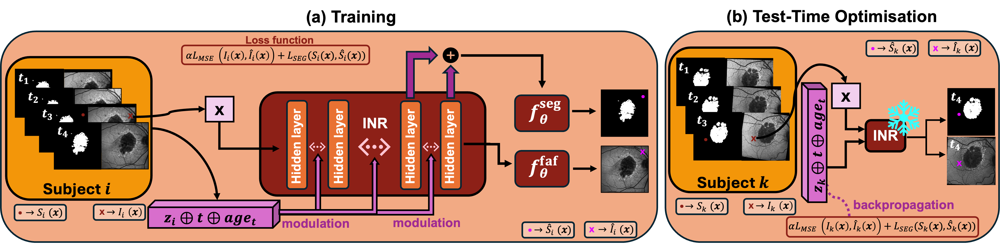

# Modelling Geographic Atrophy Progression using Implicit Neural Representations

We model the progression of geographic atrophy (GA) secondary to Age-related Macular Degeneration (AMD) from
longitudinal Fundus Autofluorescence (FAF) imaging, using Implicit Neural Representations
(INR). This repository covers data preparation, training, validation, testing, test-time optimisation,
and the figures.

<div align="center">

[]()
[](https://simonesarrocco.github.io/geographic-atrophy-progression-inr/)
[](https://off-grid-workshop.github.io/)

</div>

## Contents
- [Attribution, licence, citation](#attribution-licence-citation)
- [How it works](#how-it-works)
- [Repository layout](#repository-layout)
- [Installation](#installation)
- [Data preparation](#data-preparation)
- [The workflow: train, validate, test, forecast](#the-workflow-train-validate-test-forecast)
- [Outputs, logging, and checkpoints](#outputs-logging-and-checkpoints)
- [Reproducing the paper](#reproducing-the-paper)
- [Configuration reference](#configuration-reference)
- [Model architecture options](#model-architecture-options)

---

## Attribution, licence, citation

This work builds on a prior open-source INR framework ([`CINeMA, Dannecker et al., 2026`](https://github.com/m-dannecker/CINeMA/tree/main)); see
[`ATTRIBUTION.md`](ATTRIBUTION.md) for the credit. Released under [`LICENSE`](LICENSE) (Apache-2.0),
**except** `baselines/imageflownet/`, which is a derivative of [`ImageFlowNet, Liu et al., 2025`](https://github.com/KrishnaswamyLab/ImageFlowNet/tree/main), and carries the Yale
Non-Commercial licence shipped with it
([`baselines/imageflownet/ATTRIBUTION.md`](baselines/imageflownet/ATTRIBUTION.md)); that code is for
non-commercial research or evaluation only.

## How it works

<p align="center">
  
</p>

Each eye's disease trajectory is represented as a continuous function. One SIREN auto-decoder is
shared across the whole dataset. FiLM modulates it with an eye-specific latent grid, sampled at the
query coordinate, and with two conditioning variables: the number of weeks since the baseline visit
and the patient's age at that visit.

From one query coordinate the decoder predicts the FAF intensity (reconstruction head) and the GA
segmentation (segmentation head). The model is 2-D and resolution-agnostic.

At test time the decoder is frozen and only a new eye's latent is optimised on its available visits
(test-time optimisation, TTO). Setting the conditioning variables to another date then renders the
eye at that past or future time point.

## Multimodal FAF+SLO+GA variant

`configs/config_model_faf_slo_ga.yaml` trains a second reconstruction channel for SLO alongside FAF and
GA. The dataset section `faf_slo_ga_twovar_wktemporal_512` loads ordered targets
`['faf_path', 'slo_path', 'ga_mask_path']`; `modality_roles` explicitly distinguishes reconstruction
from segmentation, and `out_dim: [2, 2]` produces FAF+SLO followed by two GA logits. Training always
supervises all three tasks. All modalities must be spatially registered to the same grid and are
required for every retained visit; FAF and SLO intensities are normalised independently.

```bash
python run.py --config_model configs/config_model_faf_slo_ga.yaml
```

TTO can use either FAF+GA or FAF+SLO+GA on the observed visits, without changing the checkpoint or
held-out evaluation. With `optimizer.seg_loss_val: true`, select the reconstruction channels with:

```bash
# FAF+GA latent optimisation
python evaluate.py --checkpoint <multimodal_checkpoint> \
    --tto_reconstruction_modalities faf_path --output_dir <eval_faf_ga>

# FAF+SLO+GA latent optimisation
python evaluate.py --checkpoint <multimodal_checkpoint> \
    --tto_reconstruction_modalities faf_path slo_path --output_dir <eval_faf_slo_ga>
```

`seg_loss_val: false` remains the reconstruction-only ablation. Use separate output directories for
TTO modes because each saves its own latents and metrics. Evaluation reports `FAF_PSNR`/`FAF_SSIM`/
`FAF_LPIPS` and the corresponding `SLO_*` metrics separately. Unqualified PSNR/SSIM/LPIPS remain FAF
aliases for backward compatibility; the combined `LOSS` uses all training reconstruction channels.

---

## Repository layout

| Path | Role                                                                                                                      |
|---|---------------------------------------------------------------------------------------------------------------------------|
| `run.py` | Train entry point (assembles config, guards the split, launches the builder).                                             |
| `build_model.py` | Core engine (`ModelBuilder`): training, validation, test and test-time optimisation loops, checkpointing, figures.       |
| `evaluate.py` | Standalone evaluation of a checkpoint (val + test leave-one-out, forecast scenarios) writing summary CSVs.               |
| `summarise_eval.py` | Interpolation vs extrapolation summary table of the held-out visits (run by `evaluate.py`).                               |
| `run_pipeline.sh` | Runs training, evaluation and the trajectory figure in sequence.                                                          |
| `plot_lesion_size_trajectories.py` | Per-eye GA-area progression panel (the paper figure).                                                                     |
| `seg_growth.py` | Library: growth-ring and lesion-onset maps (spatial counterpart to the area plots).                                       |
| `configs/` | Model config (`config_model.yaml`), dataset config (`config_data.yaml`), split guard, lakeFS template.                    |
| `models/` | SIREN trunk, INR decoder, condition/time encoders, ω scheduler.|
| `data_loading/` | Dataset, coordinate sampling, preprocessing, optional remote (lakeFS) loader.                                             |
| `preprocessing/` | Scripts that build the clinical CSV and the train/val/test split.                                                         |
| `baselines/imageflownet/` | The paper's comparison methods (ImageFlowNet family), on the same split and scoring grid. Separately licensed, see below. |
| `docs/` | Documentation (see below).                                                                                                |
| `utils.py` | Shared library (loss, grids, image IO, logging, figure helpers).                                                          |

Documentation:
[`docs/DATA.md`](docs/DATA.md) (data preparation) ·
[`docs/REPRODUCIBILITY.md`](docs/REPRODUCIBILITY.md) (steps to reproduce the paper) ·
[`docs/BASELINES.md`](docs/BASELINES.md) (ImageFlowNet comparison).

---

## Installation

Python 3.10 and a CUDA GPU (training and evaluation run on `device: cuda`).

```bash
conda env create -f environment.yml     # creates the 'gap-inr' env
conda activate gap-inr
# or:  pip install -r requirements.txt
```

The pipeline is 2-D only. Run every command from the repository root: the configs use paths relative
to it (`./data`, `./cache`, `./runs`, `./configs`).

---

## Data preparation

The full reference is [`docs/DATA.md`](docs/DATA.md).

**1. Metadata CSV.** One row per patient-eye visit, at `tsv_file` in `configs/config_data.yaml`
(default `./data/clinical_metadata.csv`). Key columns: `Eye_ID` (identity, one latent per value),
`split` (train/val/test), `Patient_ID`, `Eye` (OD/OS), `Visit_ID`, `Visit_Number`, `faf_path`,
`ga_mask_path`, a time source (`visit_date`, `diff` or `Visit_Number`), `AgeatVisit`, and
`ScaleXSlo`/`ScaleYSlo` (mm/pixel, for areas in mm²).

**2. Conditioning variables.** The loader computes `weeks_from_baseline` from the visit dates
(`visit_date`). Any other numeric column becomes a FiLM conditioning variable once it is listed under
`conditions` and `constraints` in `config_data.yaml`. See [`docs/DATA.md` sections 2 and 3](docs/DATA.md).

**3. Folder structure.** The FAF image path is read from the CSV. The GA masks are found through a
fixed layout, `<cache_path>/<branch>/data/<Patient_ID>/<Eye>/<Vxx>/Spectralis_faf/…`
([`docs/DATA.md` section 5.2](docs/DATA.md)). Use `mask_grader_mode: single` if you have one mask per
visit; the paper uses `majority`, a majority vote over three graders.

lakeFS is optional and off by default, in which case everything is read from local disk. To use it,
copy `configs/lakefs_cfg.example.yaml` to `configs/lakefs_cfg.yaml`, fill in the endpoint, access key
and secret key, and set `repo`/`branch`/`cache_path` in the `lakefs:` block. Object keys mirror the
local layout, and files are downloaded to `<cache_path>/<branch>/data/…` on first use.

**4. Split.** The patient-wise split (26 train / 5 val / 6 test eyes) is frozen in
`configs/expected_split.yaml`, and every run aborts if the split resolved from the CSV differs.
[`docs/DATA.md` sections 5 to 7](docs/DATA.md) gives the folder trees and the full column reference.

---

## The workflow: train, validate, test, forecast

### 1. Training (`run.py`)

Trains the shared SIREN auto-decoder and the per-eye latent grids on the training eyes. The loss is
`sr_weight` (10) times the MSE of the FAF reconstruction, plus `seg_weight` (1) times the GA
segmentation loss (two-class cross-entropy + soft Dice).

```bash
python run.py                                          # uses configs/config_model.yaml
python run.py --config_model path/to/your_config.yaml  # a different config
python run.py --inr_decoder__latent_dim 256 32 32      # override one knob (list flags take integers)
```

`validate_splits()` runs first and aborts on any train/val/test overlap, or if the split differs from
`configs/expected_split.yaml`. A validation round (below) runs every `validate_every` epochs and on the
last epoch; each one writes a checkpoint, and `checkpoint_best.pth` is the one with the highest
held-out validation DICE. When training ends, the test split is evaluated once with that checkpoint,
holding out each test eye's last visit.

### 2. Validation (test-time optimisation for model selection)

The decoder is frozen and a fresh latent is optimised for each validation eye on all of its visits but
the held-out one, for `epochs.val` epochs. During training the held-out visit is the last one
(`validation.holdout_strategy: last`); it is never part of the fit, neither its image nor its mask.
Then the model renders the held-out visit and is scored on it.

- The latent is fitted with the training loss on the fitted visits (`optimizer.seg_loss_val: true`).
  `seg_loss_val: false` fits it on the reconstruction loss alone, which is the stricter ablation.
- Early stopping (`optimizer.val_early_stopping`): after every inner epoch the mean DICE over the fitted
  visits is measured; the latents of the best inner epoch are restored, and optimisation stops after
  `patience` epochs without improvement. The held-out visit plays no part in this choice.
- The latents of all eyes of the split are optimised together (one tensor, one optimiser, one
  early-stopping epoch chosen on the mean over eyes), so each eye's result also depends on the other
  eyes in the round.

Validation can also be run on its own, here with leave-one-out:

```bash
python evaluate.py --checkpoint runs/faf_ga/<run>/checkpoint_best.pth \
    --holdout_strategy leave_one_out --test off        # validation only (model selection)
```

### 3. Testing (test-time optimisation for final evaluation)

Evaluate the selected checkpoint on the test split:

```bash
python evaluate.py --checkpoint runs/faf_ga/<run>/checkpoint_best.pth \
    --holdout_strategy leave_one_out --test on
```

Leave-one-out holds out each visit position in turn (one optimisation round per position), on the
validation and the test split (`--skip_val` skips validation). `summarise_eval.py` then writes
`evaluation_*/leave_one_out_summary.csv` with held-out DICE, precision, recall, IoU, Hausdorff distance,
PSNR, SSIM, LPIPS and lesion-area MAE, per position and grouped into interpolation (the held-out visit
is not the eye's last) and extrapolation (it is). Holding out visit 1 counts as interpolation although
the latent is then fitted on later visits only; its row is reported separately.

The optimised test-time latents are saved to `evaluation_*/test_latents.pt`. Passing that file back
with `--test_latents <path>` skips the optimisation and reproduces the same numbers exactly (see
[`docs/REPRODUCIBILITY.md`](docs/REPRODUCIBILITY.md)).

### 4. Forecasting scenarios

- Scenario 1, single pair: for every visit pair (a, b) with a before b, a new latent is fitted on visit
  a only and visit b is predicted. This is the baselines' pairwise protocol. The summary goes to
  `evaluation_*/leave_one_out_summary_pairwise.csv`.
- Scenario 2, full history: the latent is fitted on all earlier visits and the last visit is predicted
  (the extrapolation rows of the leave-one-out table, or `--holdout_strategy last`). `--support_k K`
  fits on the first `K` visits and predicts all later ones.

```bash
python evaluate.py --checkpoint runs/faf_ga/<run>/checkpoint_best.pth --pairwise --skip_val
python evaluate.py --checkpoint runs/faf_ga/<run>/checkpoint_best.pth --holdout_strategy last --test on --skip_val
python evaluate.py --checkpoint runs/faf_ga/<run>/checkpoint_best.pth --support_k 1 --skip_val
```

`--epochs_val N` sets the number of epochs of each test-time optimisation round.

### 5. Figures

```bash
python plot_lesion_size_trajectories.py \
    --csv runs/faf_ga/<run>/evaluation_*/lesion_analysis/lesion_areas_test_epoch_*.csv --split test \
    --holdout-dir runs/faf_ga/<run>/evaluation_*/holdout_timeline_arrays
```

With `--holdout-dir` every observed visit is plotted as its leave-one-out prediction (the paper
figure); without it, the observed visits are reconstructions of visits the latent was fitted on. The
script's docstring and `--help` list the inputs it needs.

`./run_pipeline.sh` runs training, evaluation and this figure in sequence, on the GPU with the most
free memory (or `--gpu N`).

---

## Outputs, logging, and checkpoints

Each run creates `runs/faf_ga/<config_data>_<timestamp>_<jobid>/` with:

- `config_model.yaml` and `config_data.yaml` as read from disk, and `config_resolved.yaml`, which
  includes the command-line overrides. Reproduce a run from `config_resolved.yaml`.
- `checkpoint_best.pth` (highest held-out validation DICE), `checkpoint_best_loss.pth` (lowest held-out
  (1 - DICE) + 10 x MSE), and `checkpoint_epoch_*.pth` for every validation epoch. A checkpoint stores
  the decoder weights, the training latents, the config and the training dataframe.
- `tb_logs/` for TensorBoard (loss terms, held-out DICE/PSNR/SSIM, time-sensitivity probes,
  reconstruction figures): `tensorboard --logdir runs/faf_ga/<run>/tb_logs`.
- Per-split metric JSONs, reconstruction and publication figures, and `lesion_analysis/`.
- `evaluate.py` adds `evaluation_*/`, holding the same outputs for the evaluation plus
  `leave_one_out_summary.csv`.

For Weights & Biases logging, set `logging: True` and a `wandb_entity` in `config_model.yaml`.

---

## Reproducing the paper

[`configs/config_model.yaml`](configs/config_model.yaml) holds the paper's configuration: SIREN hidden
size 384, 8 FiLM-modulated layers, latent grid `[256, 32, 32]`, ω = 30, `sr_weight` 10, `lr_inr` 1e-4,
`lr_latent` 5e-3, seed 1927, on images centre-cropped to 620x620 pixels and resized to 512x512 pixels.
`python run.py` trains the paper model. [`docs/REPRODUCIBILITY.md`](docs/REPRODUCIBILITY.md) gives the
steps, what can and cannot be reproduced exactly, and the baseline protocol. The comparison methods
are ImageFlowNet and the two methods it was compared with in its paper, T-UNet and T-I2SBUNet
([`docs/BASELINES.md`](docs/BASELINES.md)).

---

## Configuration reference

Two YAML files are merged at startup (`run.py`):

- `configs/config_model.yaml`: model, optimiser and training (decoder architecture, `latent_dim`,
  SIREN `omega_*`, loss weights, `epochs.train`, the test-time optimisation budget `epochs.val`,
  early stopping). Its `config_data:` key names the dataset section to use.
- `configs/config_data.yaml`: the dataset sections (CSV, conditioning variables, constraints, image
  geometry). See [`configs/README.md`](configs/README.md).

---

## Model architecture options

The architectural choices live in the `inr_decoder` section of `configs/config_model.yaml`. The values
shipped there are the paper's. Each knob below can be changed in a copy of the file; a few
(`hidden_size`, `num_hidden_layers`, `latent_dim`, `modulated_layers`, `cnn_kernel_size`, `out_dim`)
also have command-line flags, listed by `python run.py --help`.

### Output heads: shared or separate
- Separate heads (default, `shared_output_layer: false`). The reconstruction head reads the last
  SIREN layer and predicts the FAF intensity; the segmentation head reads the penultimate layer and
  predicts the GA logits. Both heads also receive the modulation vector (latent + conditions). The
  shipped config sets `seg_head_use_last_features: true`, so the paper's segmentation head sees the
  penultimate *and* the last-layer features; set it to `false` for the penultimate layer alone.
- Shared output head (`shared_output_layer: true`). A single output layer maps to `[recon | seg]`
  together, as in the upstream framework. It has fewer parameters but couples the two tasks; when it
  is on, the `seg_head_*` and `seg_branch` options are ignored.

### Segmentation-head capacity
- `seg_head_num_layers: 0` gives a single linear segmentation head (default); a value above 0 gives a
  ReLU MLP of width `seg_head_hidden_size`.
- `seg_head_use_last_features: true` also feeds the last-layer features (not only the penultimate
  layer) to the segmentation head.
- Dedicated segmentation branch (`seg_branch.activate: true`): a short SIREN sub-network taps a
  mid-trunk layer (`branch_layer`, default penultimate), is FiLM-modulated by the latent, and decodes
  labels through its own layers. It gives the segmentation more capacity than the head while still
  sharing the trunk, and replaces the penultimate segmentation head when active.

### Temporal conditioning: FiLM or input coordinate
- FiLM conditioning (default). Every enabled condition (weeks from baseline and age at visit in the
  paper) modulates the SIREN through FiLM. Its encoding is set by `cond_encoding`: `raw` (the
  normalised value, used in the paper), `mlp` (learned embedding), `mlp_separate` (one MLP per
  variable) or `fourier` (`cond_num_frequencies` bands).
- Time as input (`time_as_input: true`). The temporal variable enters as an extra INR input
  coordinate, optionally Fourier-encoded via `time_num_frequencies`. With a bare scalar
  (`time_num_frequencies: 0`) the decoder can ignore the time axis and emit the same image for every
  visit, so raise the frequency count when using this mode.
- `modulated_layers` sets which SIREN layers receive FiLM modulation (default: all).

### Latent representation
- `latent_dim: [C, H, W]` is the per-eye latent grid (C channels on an H x W grid), bilinearly
  sampled at each query coordinate. A finer grid carries more per-eye detail; a grid that is too
  coarse blurs the reconstruction.
- Per-eye vs per-visit latents. By default one latent is shared across an eye's visits and time enters
  through conditioning. `independent_visits: true` (in `config_data.yaml`) gives one latent per visit
  instead (each visit is treated as an independent patient/eye).
- `cnn_kernel_size` adds a convolution that spatially mixes the latent grid before sampling (`0`, the
  paper setting, means no convolution).

### SIREN frequency (ω) schedule
`omega_0` (first layer) with `omega_start`/`omega_end` and `schedule_type` (`constant`, `linear`, or
`exponential`) set the SIREN activation frequency per layer, which trades detail against smoothness.
Low frequencies bias the decoder towards coarse shape with no vessels or texture. These keys have no
command-line flag; change them in a copy of the config.

### Inference post-processing
- `renormalize_output: true` (paper setting) min-max stretches each rendered FAF image to [0, 1]
  before it is scored or plotted, matching the per-visit min-max normalisation of the ground truth.
- `seg_threshold` is the cutoff on P(GA) for the binary mask (0.5 in the paper, equivalent to argmax).
- `seg_postprocess` (`keep_largest`, `min_area_px`) removes small connected components from the GA
  mask (off in the paper).

---
